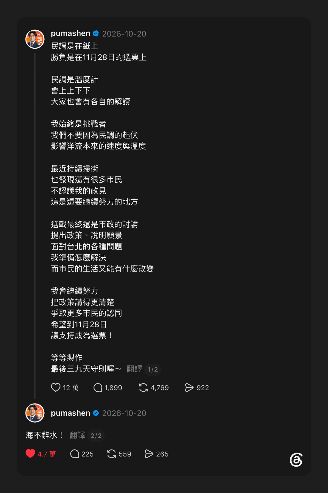

10 月 20 日，信民兩岸研究協會公布台北市長民調，「支持度」這一項[沈伯洋](https://zh.wikipedia.org/zh-tw/沈伯洋) 50.3%，[蔣萬安](https://zh.wikipedia.org/zh-tw/蔣萬安) 33.3%。沈伯洋發文回應，說民調是在紙上，勝負要看 11 月 28 日的選票。接著他在自己貼文的留言區，補了四個字給支持者：「海不辭水！」

這四個字傳得比那則貼文還遠。很快就有網友替他把出處補齊：《管子·形勢解》，「海不辭水，故能成其大；山不辭土石，故能成其高；明主不厭人，故能成其眾；士不厭學，故能成其聖。」附上的解釋大致是胸懷寬廣、有容乃大，懂得廣納細流、謙虛學習，才能成就大事。一位國文老師也[發文](https://www.setn.com/news/1926457)，謝謝他讓學生想讀書。

這句話的意思看起來很清楚，大概沒人覺得需要多解釋。我順著出處往下查，發現它也出現在別的地方。2009 年它出現在北京的[中央黨校](https://zh.wikipedia.org/zh-tw/中共中央黨校)，2018 年又出現在[中非合作論壇](https://zh.wikipedia.org/zh-tw/中非合作論壇)的開幕致詞，兩次說話的都是[習近平](https://zh.wikipedia.org/zh-tw/習近平)。

同一句話換了場合，「海」和「水」指的對象就跟著換。下面先把原文擺出來，再一個一個看這些場合怎麼用它。

## Table of contents

## 一、這句話原本在說什麼

「海不辭水」出自[《管子》](<https://zh.wikipedia.org/zh-tw/管子_(書)>)第六十四篇〈形勢解〉。〈形勢解〉是解說第二篇〈形勢〉的文字，屬於《管子》現存的幾篇「解」之一。書名掛著[管仲](https://zh.wikipedia.org/zh-tw/管仲)，但一般認為是[戰國時期齊國稷下學者](https://zh.wikipedia.org/zh-tw/稷下學宮)，甚至更晚的人陸續寫成的，所以說「《管子》裡寫道」比「管仲說」準確。

這四句在原書裡，後面還接著一段話：

> 飺者，多所惡也。諫者，所以安主也。食者，所以肥體也。主惡諫則不安，人飺食不肥；故曰：「飺食者不肥體也。」

引文依通行的標點本。參考資料裡維基文庫的四庫全書本，在「人飺食」和「不肥」之間多一個「則」字，其餘相同。

「飺」是挑食。這段話的意思是挑食的人長不胖，討厭進諫的君主位子坐不穩。前面的海和山是比喻，落點在「明主不厭人，故能成其眾」：君主不排斥人，人就會歸附到他身邊。整段是寫給統治者看的。

「厭」字有兩種讀法。一種是嫌棄、厭煩，「不厭人」就是不嫌棄人；另一種通「饜」，是滿足的意思，「不厭人」就是對人才永不嫌多。對照後文的「飺」（嫌食），第一種讀法比較順。「士不厭學」則接近《論語》的「學而不厭」。

類似的比喻在先秦到漢代並不少見。[《淮南子·泰族訓》](https://zh.wikipedia.org/zh-tw/淮南子)說「海不讓水潦以成其大，山不讓土石以成其高」，《文子·自然》也有相近的句子。[李斯〈諫逐客書〉](https://zh.wikipedia.org/zh-tw/諫逐客書)的「泰山不讓土壤，故能成其大；河海不擇細流，故能就其深」，同樣是寫給君王看的，勸秦王不要驅逐外來的人才。

## 二、黨校講台：2009 年

2009 年 11 月 12 日，時任國家副主席、兼任中央黨校校長的習近平，在中央黨校秋季學期第二批進修班開學典禮上講話。談到領導幹部的學習，他說要廣學博學，「幹什麼學什麼、缺什麼補什麼」，接著引了「海不辭水，故能成其大；山不辭土，故能成其高」。

這裡的聽眾是黨的幹部，講的是個人學習。海是想讓自己變大的幹部，水是他要學的新理論和新知識。四句裡真正對應的是最後一句「士不厭學，故能成其聖」，君主那一層並不在這個場合裡。

## 三、國際峰會：2018 年

2018 年 9 月 3 日，中非合作論壇北京峰會開幕，台下坐的是非洲各國元首，還有聯合國和非洲聯盟的領袖。習近平在主旨講話裡說：

> 「海不辭水，故能成其大。」中國是世界上最大的發展中國家，非洲是發展中國家最集中的大陸，中非早已結成休戚與共的命運共同體。

接下來他講的是共築更加緊密的中非命運共同體，為「人類命運共同體」樹立典範。

這一次，比喻被放到國與國的關係上。兩個月後，他在[上海首屆進口博覽會](https://zh.wikipedia.org/zh-tw/中國國際進口博覽會)說「中國經濟是一片大海，而不是一個小池塘」。把兩次講話放在一起看，海比較像中國，或是中國倡議的那個共同體；水則是願意加入的非洲國家。這個結構跟〈形勢解〉有點像，一方在上面接納，另一方往它匯過去。差別在原文的明主是一個人，這裡換成了一個國家。

## 四、選戰留言區：2026 年

回到台北。在沈伯洋這邊，水的意象早就在了。八月他到寧夏夜市掃街，支持者自己做了寫著「洋流」的橘色海報，團隊隨後把它變成競選口號。支持者自稱「小水滴」，叫他「船長」，政見裡也有一項「台北水文化復興」。

（[原文](https://www.threads.com/@pumashen/post/DetIpbelJry)）

所以「海不辭水！」放在這裡，幾乎不用解釋。說話的是候選人，聽的是自己的支持者；水是每一位小水滴，海是他們匯成的洋流。時機是民調領先之後，前文剛說完勝負要看選票，這四個字讀起來比較像在提醒支持者別鬆手，每一滴都還要算進去。

跟前兩個場合比，方向剛好倒過來。黨校和峰會裡，海是主動接納的一方；在這裡，海本身就是由水滴組成的，支持者口中的「船長」，在這個比喻裡比較像站在甲板上的人。

沈伯洋只寫了四個字，沒有多做說明。上面的讀法是從場合和陣營原有的用語推出來的，他本人怎麼想，材料裡看不出來。

## 五、教科書裡的海

回頭看開場那段，網友替沈伯洋補出處時附上的解釋：胸懷寬廣、有容乃大，廣納細流、謙虛學習。[媒體報導](https://www.setn.com/news/1926457)時引的也是同一類釋義，把它說成人要有包容力、懂得廣納意見。

教育部《成語典》裡查得到「海不辭水，故能成其大」，但只列在辭典附錄的「編輯總資料庫」，註明取自《成語大辭典》，沒有釋義。常見的那個解釋沒有官方版本，是靠網友轉貼和媒體報導傳開的。

這個版本我們最熟，熟到不覺得它是一種「用法」。放在〈形勢解〉旁邊看，它其實也是後來長出來的意思：君主被拿掉了，海變成任何一個想讓自己變大的人，水是意見和知識。這個版本住在用典文章和考試講義裡，讀的人是學生，或是想勉勵自己的人。

在教科書裡，海是一個有胸襟的人；在〈形勢解〉裡，海是君主。政大有一篇研究成語古今義變的碩士論文，整理過先秦成語流傳到現代的變化，其中一個趨勢就是語義變得更簡明、更通俗。這兩個版本到現在都還有人用，各自待在自己的場合裡。

## 六、誰是海，誰是水

把五個場合排在一起，句子沒變，變的是填進「海」和「水」的對象。

| 場合                 | 說話者 → 聽眾         | 海                   | 水             |
| -------------------- | --------------------- | -------------------- | -------------- |
| 〈形勢解〉           | 作者 → 君主           | 明主                 | 臣民、進諫的人 |
| 中央黨校（2009）     | 習近平 → 黨內幹部     | 求學的幹部           | 新理論、新知識 |
| 中非合作論壇（2018） | 習近平 → 非洲各國元首 | 中國／中非命運共同體 | 非洲各國       |
| 台北選戰（2026）     | 沈伯洋 → 支持者       | 洋流                 | 小水滴         |
| 課本、成語釋義       | 老師 → 學生           | 有胸襟的個人         | 意見、知識     |

一個比喻能流傳兩千多年，靠的大概就是這種彈性。海和水只規定了一種關係：大的東西由小的東西匯成，而且不挑。至於誰是海、誰是水，每個場合會自己填上去。君臣、師生、黨與幹部、國與國、候選人與選民，這幾組關係差很多，句子卻幾乎不用改。

下次在別的地方聽到這句話，我大概會先看說話的人站在哪裡，台下坐的又是誰。

## 參考資料

- [中國哲學書電子化計劃：管子·形勢解 相似段落](https://ctext.org/text.pl?node=48767&if=gb&show=parallel)
- [維基文庫：管子（四庫全書本）](<https://zh.wikisource.org/zh-hant/%E7%AE%A1%E5%AD%90_(%E5%9B%9B%E5%BA%AB%E5%85%A8%E6%9B%B8%E6%9C%AC)/%E5%85%A8%E8%A6%BD>)
- [詩詞匯：諸子喻山水（「厭」字解）](https://www.shicihui.com/zh-tw/poem/zhuziyushanshui)
- [環球網：大大用典【海不辭水，故能成其大】（2009 中央黨校講話）](https://m.huanqiu.com/article/9CaKrnK0t0W)
- [中國外交部：2018 年中非合作論壇北京峰會開幕式主旨講話全文](https://www.mfa.gov.cn/web/ziliao_674904/zyjh_674906/201809/t20180903_9870267.shtml)
- [共產黨員網：海不辭水，故能成其大（詳解版）](https://www.12371.cn/2021/04/07/VIDE1617795841371520.shtml)
- [中央社：習近平進博會演講 中國經濟是大海掀不翻](https://www.cna.com.tw/news/acn/201811050048.aspx)
- [三立新聞：沈伯洋民調領先 17% 喊「海不辭水」](https://www.setn.com/news/1926457)
- [自由時報：「洋流」一詞的由來與 Threads 粉絲數](https://news.ltn.com.tw/news/politics/breakingnews/5588803)
- [Yahoo 新聞：台北水文化復興政見](https://tw.news.yahoo.com/%E6%B4%8B%E6%B5%81-%E5%8C%85%E8%88%B9-%E6%B5%B7%E6%88%B0-%E4%BB%96%E8%AE%9A%E5%A5%91%E5%90%88%E6%B2%88%E4%BC%AF%E6%B4%8B1%E6%94%BF%E8%A6%8B-%E5%96%8A%E8%A9%B1%E5%B0%8F%E6%B0%B4%E6%BB%B4-011700533.html)
- [政大碩士論文：成語古今義變研究（2011）](https://thesis.lib.nccu.edu.tw/detail/41e3402f61bac7d59ad93a3f6e19cfcd/)
- [教育部《成語典》：海不辭水，故能成其大（辭典附錄・編輯總資料庫）](https://dict.idioms.moe.edu.tw/idiomView.jsp?ID=71326)
