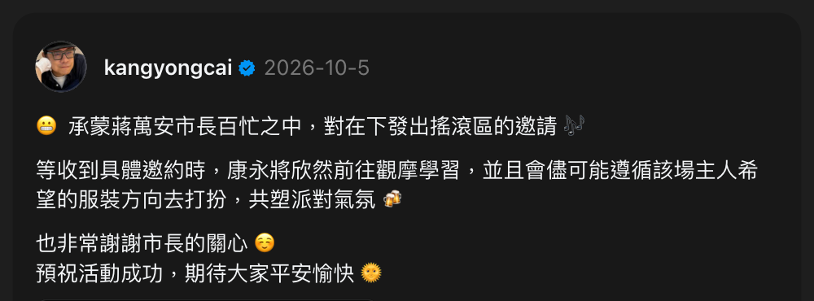
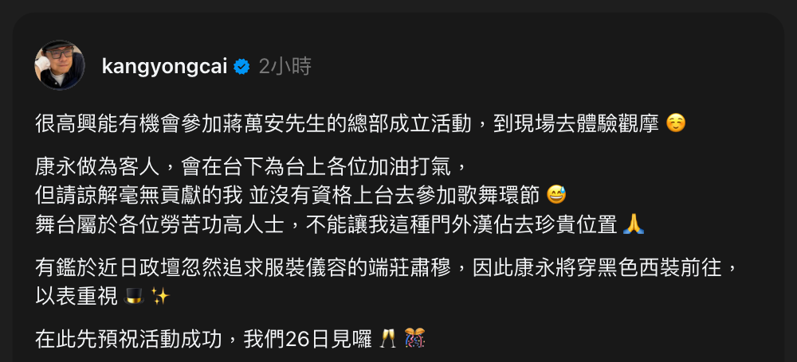

在人人都被要求選邊的時刻，蔡康永用一封民國書信的體例，客客氣氣地劃出了距離。他的筆法，最像錢鍾書。

## Table of contents

## 一則邀約，兩則回覆

十月四日，[蔡康永](https://zh.wikipedia.org/wiki/蔡康永)出現在民進黨台北市長參選人[沈伯洋](https://zh.wikipedia.org/wiki/沈伯洋)的競選總部成立大會。記者問他是不是來支持沈伯洋，他只說「就是來見識一下」；經紀人則說，團隊正考慮專訪兩位台北市長候選人（[自由時報](https://ent.ltn.com.tw/news/breakingnews/5595582)）。

消息傳到對岸，大陸網友發現他那個有三千六百萬粉絲的微博已經清空，當成他表態的證據。其實那個帳號早在 2022 年底就清空了，這次是舊事被重新翻出來（[三立新聞網](https://star.setn.com/news/1917448)）。合作過的[零跑汽車](https://zh.wikipedia.org/wiki/零跑汽車)則連夜發聲明，說他「並非零跑代言人」，撤下相關內容（[世界日報](https://www.worldjournal.com/wj/story/121218/9797443)）。

隔天，台北市長[蔣萬安](https://zh.wikipedia.org/wiki/蔣萬安)受訪表示，尊重蔡康永發表任何主張的自由，並邀他出席自己的競總成立活動，笑說「一定會安排在搖滾區」。這是一份善意，也是一份算計。被邀請的人，要怎麼回？

蔡康永當天就在 Threads 回了第一則，接下邀請，說會「欣然前往觀摩學習」（[ETtoday](https://star.ettoday.net/news/3249313)）。

六日晚間，解放軍新聞傳播中心旗下的「鈞正平工作室」不點名發文，指有人「一邊賺著大陸紅利，一邊與台獨眉來眼去」，警告將付出「難以承受的代價」（[聯合新聞網](https://udn.com/news/story/6656/9803148)）。從企業切割到軍方帳號下場，只用了兩天。

十月十五日，離蔣萬安十月二十六日的競總成立大會還有十一天，他發了第二則，說明出席方式（[TVBS](https://news.tvbs.com.tw/entertainment/variety/4036361)）。

兩則讀完，我腦中浮現的不是任何當代人物，而是[錢鍾書](https://zh.wikipedia.org/wiki/錢鍾書)。

## 四種筆法

### 以尺牘為殼

兩則回覆的骨架是民國書信。他自稱「康永」、「在下」，開頭是「承蒙……百忙之中」，結尾是「在此先預祝活動成功」。這些不是社群語言，是尺牘的格式。

以名自稱是舊式書信的謙辭，今天幾乎只在正式函件裡見得到。放進 Threads，夾在一串表情符號之間，本身就是一種落差：語氣越古典，內容越像一場表演。

蔡康永的家世可以追溯到民國時期的上海。這種語感對他來說不是學來的，比較像是家裡的。錢鍾書寫信也是這個路數，禮數周全到挑不出毛病。

### 謙辭過量，量變成質

客氣有一個臨界點。低於它是禮貌，超過它就成了評論。

媒體先前報導，蔣萬安的競總成立大會也要邀他上台一起唱競選主題曲〈台北安可〉（[壹蘋新聞網](https://news.nextapple.com/entertainment/20261015/3FAD30F6CC433FEB159B1F686A0D3650)）。第二則回覆裡，他說「毫無貢獻的我 並沒有資格上台」，又說「舞台屬於各位勞苦功高人士」。表面是自貶，實際上是把對方捧上高台。而被捧上高台的人，最難下台。

「勞苦功高」用在一場競總成立的歌舞環節，詞義與場合之間的落差就是諷刺所在。錢鍾書在[《圍城》](<https://zh.wikipedia.org/wiki/圍城_(小說)>)裡最擅長這一手：敘事語氣越正經、越恭敬，被描述的事就越顯荒謬。

### 毒藏在一個副詞裡

整段最鋒利的一句是：「有鑑於近日政壇忽然追求服裝儀容的端莊肅穆，因此康永將穿黑色西裝前往，以表重視」。

這句話有背景。前一天，民進黨立委[賴惠員](https://zh.wikipedia.org/wiki/賴惠員)在立法院財政委員會上，提醒來備詢的台北 101 董事長[賈永婕](https://zh.wikipedia.org/wiki/賈永婕)「穿得要純樸」，引來一片批評。[賴清德](https://zh.wikipedia.org/wiki/賴清德)總統也發文說，專業不該只用穿著評斷。賴惠員當晚改口，承認表達「確實有不妥當的地方」（[聯合新聞網](https://udn.com/news/story/6656/9814941)）。

殺傷力全在「忽然」兩個字。他不罵人、不點名，只用一個副詞暗示：政壇以前並不在乎這件事。

他要去的是國民黨候選人的場子，刺的卻是民進黨立委的發言。九天前北京的軍方帳號才暗指他「與台獨眉來眼去」，這句話又順手碰了綠營一下，哪一邊都不好把他算成自己人。

後半句再補一刀。既然服儀忽然這麼重要，他就穿最守規矩的黑西裝出席，把這套標準原封不動地奉還。在單一字詞上下毒，是錢鍾書的招牌；讀者笑出來的那一刻，才發現自己已經被說服了。

### 借官腔說私話

「觀摩學習」、「預祝活動成功」、「以表重視」，都是兩岸共通的官式致詞套語。它們的功能是安全：說了等於沒說，誰也挑不出錯。

蔡康永選在這個時間點用這套語言，本身就是一層表演。第一則發出時，對岸的抵制才剛開始；到第二則，解放軍帳號已經發過警告。台灣兩個陣營都在看他怎麼站。他用最官方的辭令回應，讓任何一方都抓不到把柄。

## 為什麼是錢鍾書

### 不是魯迅，也不是梁實秋

論技法，[魯迅](https://zh.wikipedia.org/wiki/魯迅)其實同源。他擅長反語，也常把對手的話加上引號原封奉還，像「正人君子」。但兩人的溫度完全不同。

魯迅是匕首，讀完會留下傷口，被諷刺的人只能翻臉。蔡康永留下的是笑聲，被諷刺的人也只能笑著接受，翻臉反而輸了。這種讓對方無法生氣的分寸，屬於錢鍾書。

[梁實秋](https://zh.wikipedia.org/wiki/梁實秋)與[林語堂](https://zh.wikipedia.org/wiki/林語堂)的溫度對了，但《雅舍小品》式的幽默以自嘲為主，很少帶明確的指向。蔡康永這兩則每一句都有標的，比他們鋒利。

### 以禮拒人

兩人最深的共通點不在修辭，而在姿態：用禮貌劃出距離。

錢鍾書一生都在處理被邀請、被拉攏、被要求表態的局面。他的方法是禮數做足，但人不進去。流傳甚廣的那句婉拒，說吃了雞蛋覺得不錯，何必認識下蛋的母雞，就是典型：答覆周到，語氣幽默，門是關著的。

蔡康永這次也一樣。邀請收下了，人也會到，但只坐台下、不上台、不唱跳、穿黑西裝。他接住了蔣萬安的善意，同時拒絕被當成任何一方的道具。

兩人還有一層相似：都處在說錯一個字就會被放大的壓力下。錢鍾書在政治運動的年代靠克制與機鋒並存；蔡康永面對北京的點名與台灣選戰的拉扯，選的是同一條路。

## 結語：屬於蔡康永自己的部分

當然有不同之處。錢鍾書的刻薄有時會溢出來，對學界同儕下筆並不太留情。蔡康永幾乎從不讓刻薄外露，那是電視媒體與演藝圈幾十年練出來的分寸。

還有表情符號。在這兩則貼文裡，它們不是裝飾，而是把文言客套的冷感軟化成綜藝式的親切。這不屬於任何民國文人，倒像是台灣九〇年代民主化之後，大眾文化開出來的果。民國的禮數，疊上解嚴後綜藝節目養出來的戲謔，才是蔡康永。

兩則短貼文是很小的樣本，說是師承並不嚴謹，說是氣質相近比較準確。但在一個人人都被要求選邊、表態、喊口號的時刻，還有人能用一封民國書信的體例，客客氣氣地說「不」，這件事本身就值得記下來。
